# Jobify

[](https://github.com/4K45H107/JOBIFY/actions/workflows/ci.yml)

**A hiring platform with both sides in one app.** Job seekers find jobs, apply in one click, take a
skill test and join a video interview. Employers post jobs, screen applicants, set multiple-choice or
coding tests, and interview candidates while watching them write answers live.

**Live demo: [jobify-hire.vercel.app](https://jobify-hire.vercel.app)**

| Sign in as | Email                 | Password       |
| ---------- | --------------------- | -------------- |
| Job seeker | `seeker@jobify.dev`   | `Password123!` |
| Employer   | `employer@jobify.dev` | `Password123!` |

The demo runs on free plans, so the first visit after a quiet spell can take up to a minute while
the server wakes up.

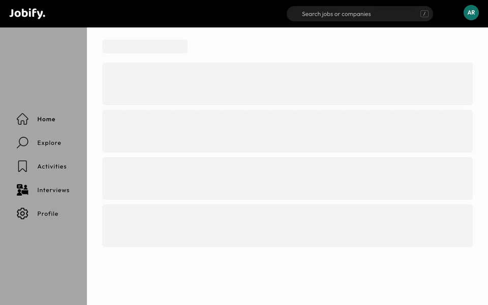

A rebuild of our 2024 university team project ([CSE408, BUET](#credits)), from a prototype into a
deployed, tested product.

## Screenshots

|                                                                                    |                                                                                       |
| ---------------------------------------------------------------------------------- | ------------------------------------------------------------------------------------- |
| 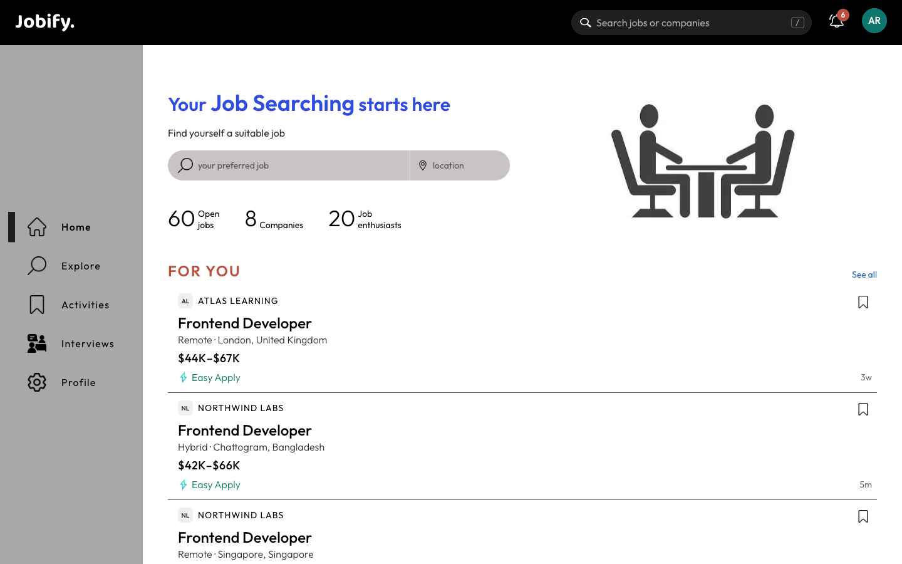                 | 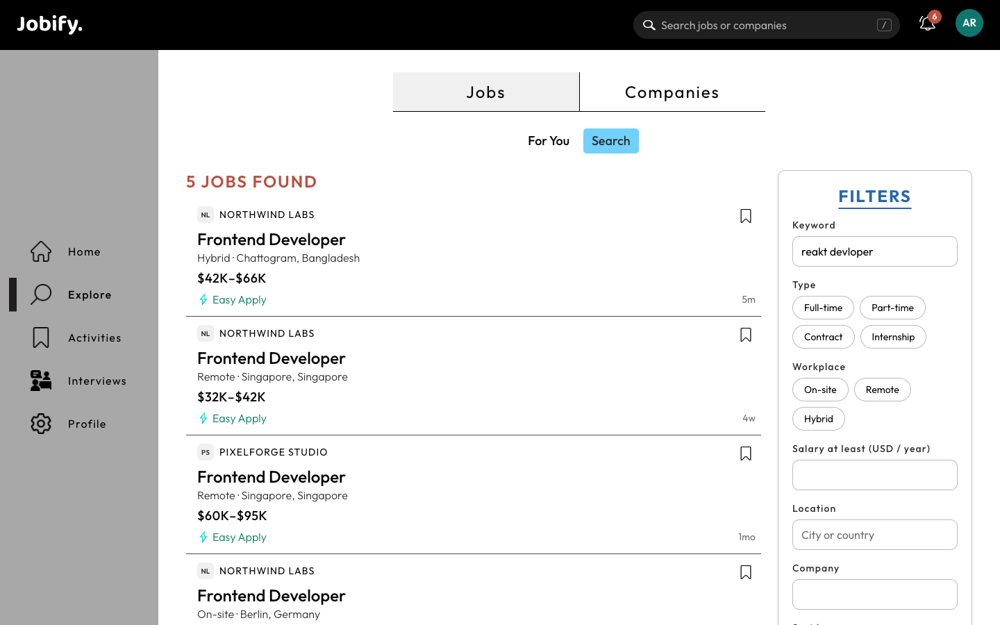      |
| **Home:** jobs picked for you, with the reasons                                    | **Search:** word forms, synonyms and typos ("reakt devloper")                         |
| 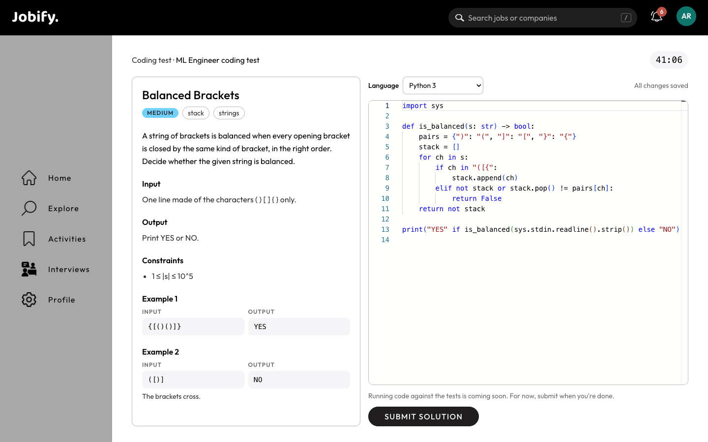 | 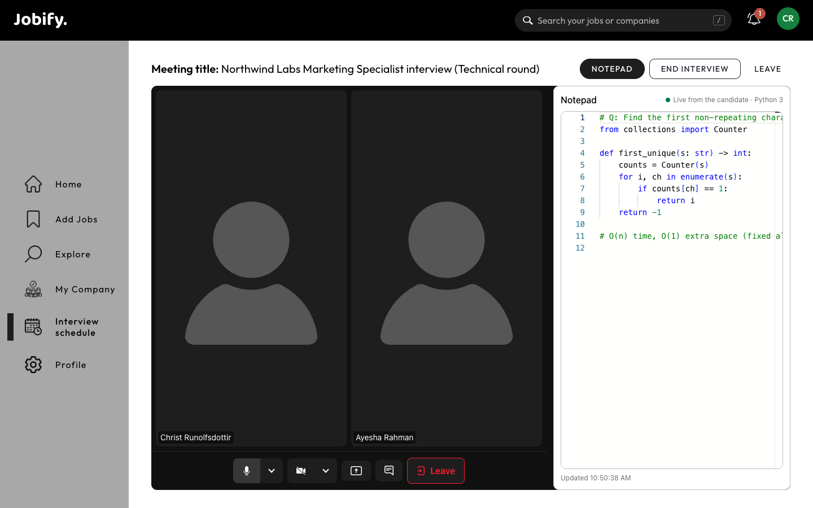 |
| **Coding test:** problem beside a highlighting editor, autosaved, timed            | **Interview:** video call, and the candidate's notepad live for the interviewer       |
| 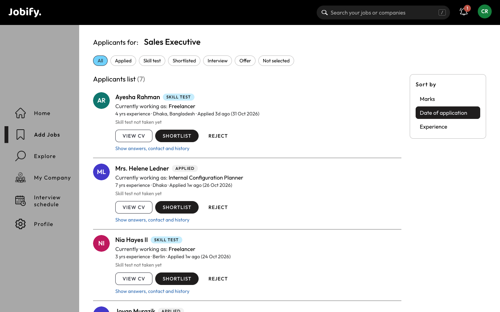                    | 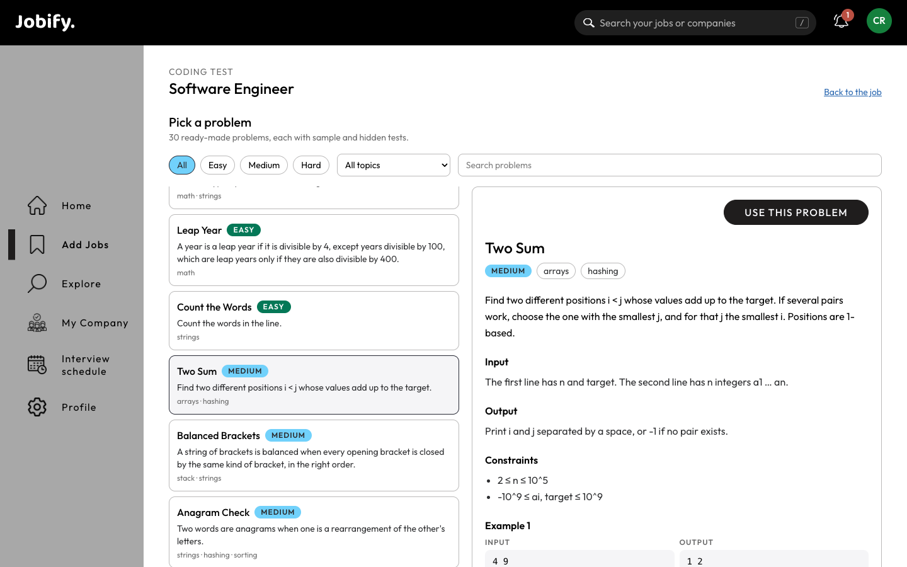     |
| **Applicants:** scores, stages, CV viewer, scheduling                              | **Problem library:** 30 problems, filter and preview                                  |
| 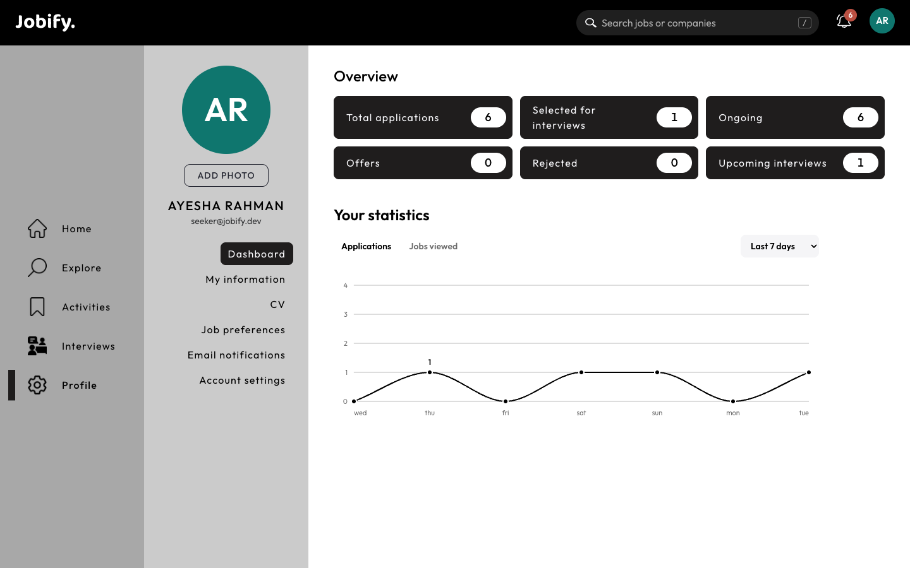       | 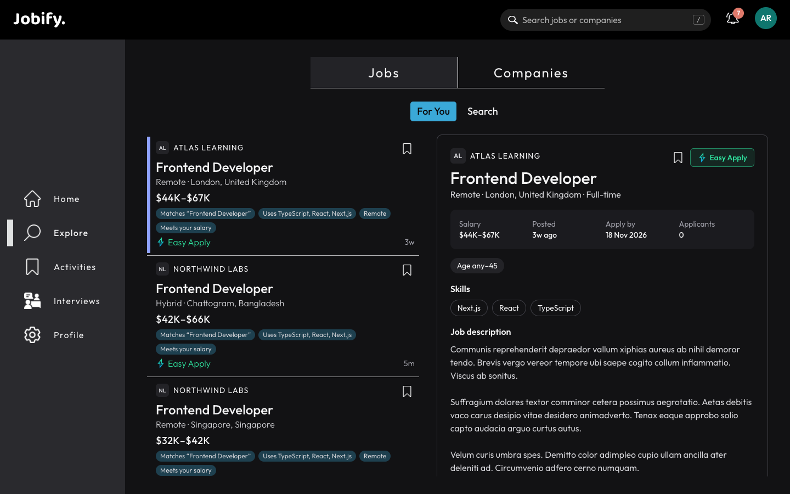                                         |
| **Dashboard:** counts and a 7/30-day activity chart                                | **Dark mode**, plus light and system                                                  |

<p align="center">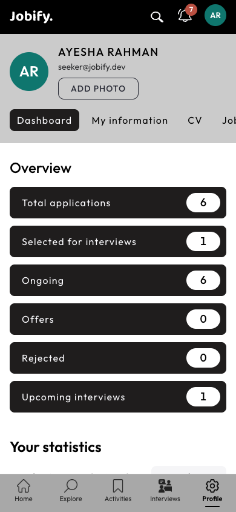</p>

## Features

**For job seekers**

- A profile with skills, CV and preferences, and **"For you" recommendations** that explain why.
- **Search** that understands word forms, abbreviations, synonyms and typos, ranked by best match.
  A header search suggests jobs and companies as you type (`/` to focus).
- **Easy Apply:** contact details, a snapshot of the CV, and the employer's screening questions.
- **Skill tests:** timed multiple choice graded on the server, or a coding problem in a code editor.
- **Video interviews** with a countdown, reminders, and a notepad (text or highlighted code) the
  interviewer sees live.
- Saved and recent jobs, applications by stage, a dashboard, live notifications and email.

**For employers**

- Create a company or ask to join one; admins approve recruiters.
- Post jobs with screening questions, then add a **multiple-choice test** or pick a **coding
  problem** from a library of 30.
- An **applicants board:** sort by marks or experience, read CVs and code, shortlist, make offers,
  reject, and schedule interviews (with clash checks).
- Run interviews and end them for everyone. The candidate's notes are saved afterwards.

**Platform**

- **Accounts:** email verification, password reset, and Google sign-in.
- **Email:** settings for each type of email, and one-click unsubscribe.
- **Interface:** light, dark and system themes, responsive layouts, and accessibility checked with
  axe-core (WCAG 2.1 AA).
- **Resilience:** friendly 404, error and loading pages, including for a sleeping server.

## Architecture

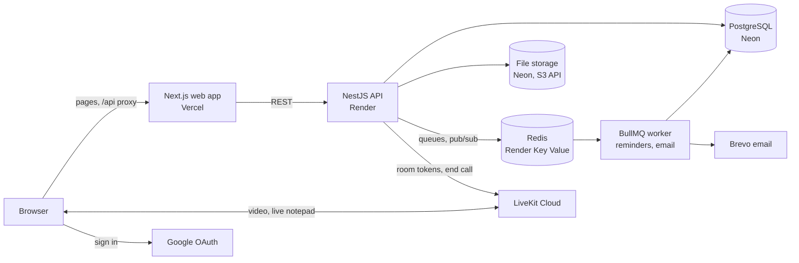

- **A modular monolith:** one API with a module per domain, plus a background worker. Modules talk
  through services, not each other's tables.
- **Browser traffic** goes through the web app's `/api` proxy, so sign-in cookies stay first-party.
- **Shared validation:** Zod schemas in `packages/shared` validate requests in the API and forms in
  the web app.
- **Live updates:** notifications reach the browser over Server-Sent Events, fed by Redis pub/sub.
  The interview notepad uses the LiveKit room's text streams.

Why it's built this way: [`docs/adr/`](docs/adr/) has a short record of each key decision.

## Tech stack

| Area           | Choices                                                                                                |
| -------------- | ------------------------------------------------------------------------------------------------------ |
| Web            | Next.js 15 (App Router), React 19, Tailwind CSS v4, react-hook-form, Monaco editor, LiveKit components |
| API            | NestJS 11, Prisma 7, Zod (nestjs-zod), argon2, jose, BullMQ, livekit-server-sdk                        |
| Data           | PostgreSQL (full-text search, pg_trgm, fuzzystrmatch), Redis, S3-compatible storage                    |
| Email          | React Email, Brevo (production), Mailpit (local)                                                       |
| Tooling        | pnpm, Turborepo, TypeScript, Vitest, Testing Library, Supertest, ESLint, Prettier                      |
| CI and hosting | GitHub Actions (with a gitleaks secret scan), Vercel, Render, Neon, LiveKit Cloud                      |

## Quality

- **About 380 tests:** unit tests, component tests (Testing Library) and API end-to-end tests
  (Supertest against a real Postgres).
- **CI on every pull request:** format, build, migrations and seed, lint, typecheck, tests and a
  secret scan.
- **Accessibility:** about 40 pages scanned with axe-core in light and dark mode (0 violations),
  with keyboard flows and focus handling in dialogs.
- **Security:** argon2id passwords, rotating refresh tokens with reuse detection, role and ownership
  checks on every endpoint, rate limits, and hidden test answers that never reach a browser. See
  [`docs/AUTH.md`](docs/AUTH.md).

## Running it locally

Requirements: Node 22+, pnpm 10 (`corepack enable`), Docker.

```bash
pnpm install
cp .env.example .env
pnpm services:up  # Postgres (5433), Redis (6379), SeaweedFS S3 (8333), LiveKit (7880), Mailpit (8025)
pnpm db:deploy    # create the database tables
pnpm db:seed      # demo data (re-runnable)
pnpm dev          # web on :3000, API on :4000/api, worker
```

Open http://localhost:3000 and sign in with a demo account above. The API docs (OpenAPI) are at
http://localhost:4000/api/docs. The full guide, with every demo account, things to try and
troubleshooting, is [`docs/RUNNING_LOCALLY.md`](docs/RUNNING_LOCALLY.md).

| Command          | What it does                |
| ---------------- | --------------------------- |
| `pnpm build`     | Build every app and package |
| `pnpm lint`      | ESLint                      |
| `pnpm typecheck` | TypeScript, no emit         |
| `pnpm test`      | All tests                   |
| `pnpm format`    | Prettier                    |

### Repository layout

```
apps/web          Next.js frontend
apps/api          NestJS API (modular monolith)
apps/worker       Background jobs (BullMQ): interview reminders and emails
packages/db       Prisma schema, migrations, client and seed data
packages/shared   Zod schemas, types and enums shared across apps
packages/email    Email templates (React Email), sending (Brevo / SMTP), unsubscribe tokens
packages/tsconfig Shared TypeScript configs
```

## Documentation

| Guide                                                | What's in it                                                             |
| ---------------------------------------------------- | ------------------------------------------------------------------------ |
| [`docs/RUNNING_LOCALLY.md`](docs/RUNNING_LOCALLY.md) | Setup, demo accounts, things to try, troubleshooting                     |
| [`docs/DEPLOYMENT.md`](docs/DEPLOYMENT.md)           | Which service runs what, how each was set up, free-tier limits           |
| [`docs/AUTH.md`](docs/AUTH.md)                       | Sign-in, sessions and Google sign-in, checked against OWASP and NIST     |
| [`docs/EMAIL.md`](docs/EMAIL.md)                     | How email works, and alternatives                                        |
| [`docs/WORKER.md`](docs/WORKER.md)                   | Background jobs: reminders and email                                     |
| [`docs/CODE_RUNNER.md`](docs/CODE_RUNNER.md)         | Coding tests, and how Judge0 would grade them                            |
| [`docs/adr/`](docs/adr/)                             | Architecture decision records                                            |
| [`PLAN.md`](PLAN.md)                                 | Features, architecture and the roadmap, with what's done and what's next |

## What's next

- Grade coding tests automatically with a code runner (self-hosted Judge0; see
  [`docs/CODE_RUNNER.md`](docs/CODE_RUNNER.md)).
- Job alerts with a daily digest, and a Playwright test of the main path.
- Two people editing the interview notepad at once, and a whiteboard.
- Account extras: MFA, a list of signed-in devices, and self-service account deletion.

## Credits

Jobify started as a team project for **CSE408** at **BUET** in 2024:
[4K45H107/CSE408_JOBIFY](https://github.com/4K45H107/CSE408_JOBIFY). The original team shaped the
idea, the features and the Figma design that this interface still follows.

This repository is a from-scratch rebuild of that project: a new architecture, backend and
database, deployment, tests, and the features above.
