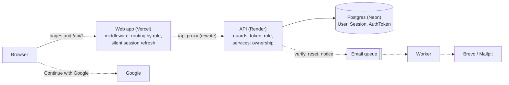
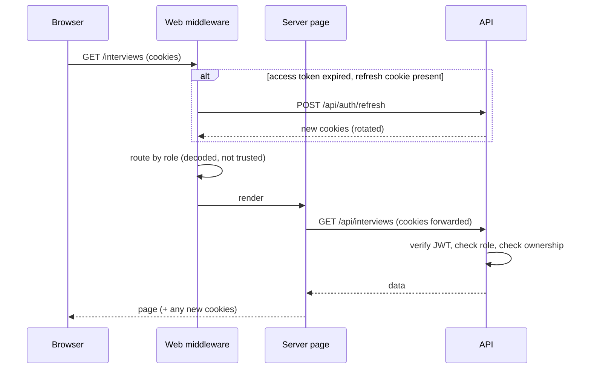
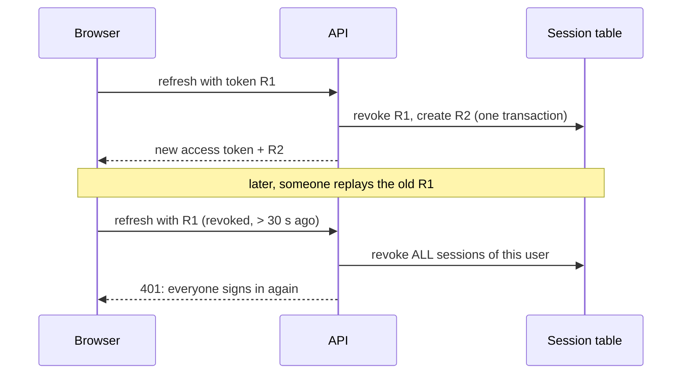
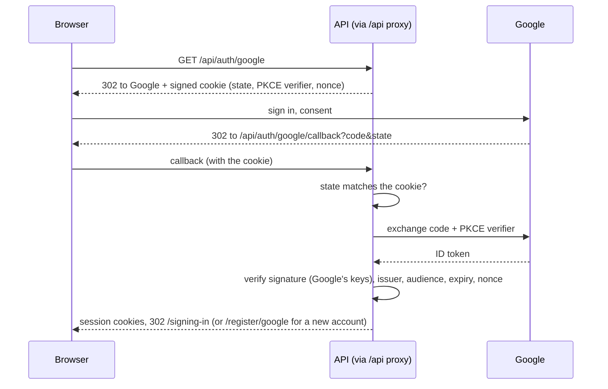

# Authentication

How signing in works in Jobify: accounts, sessions, email verification, passwords and Google
sign-in, where the code is, and how it measures up against common security standards.

Jobify runs its own authentication (no Auth0 or Firebase). Google is one extra way in; after it,
everything works the same as a password sign-in.

## The big picture

The browser only ever talks to the web app's domain. `/api/*` is passed on to the API, so the
session cookies are **first-party** cookies of `jobify-hire.vercel.app`.

## Sessions: two cookies

| Cookie           | Contents                                                                                  | Lifetime   | Stored server-side               |
| ---------------- | ----------------------------------------------------------------------------------------- | ---------- | -------------------------------- |
| `jobify_access`  | A JWT: user id (`sub`) and role, signed (HS256) with `JWT_ACCESS_SECRET`, issuer `jobify` | 15 minutes | No: the API checks the signature |
| `jobify_refresh` | 32 random bytes (opaque)                                                                  | 30 days    | Its SHA-256, as a `Session` row  |

Both are `HttpOnly` (scripts can't read them), `SameSite=Lax` and, in production, `Secure`.

- The **access token** is checked on every request without a database query: fast.
- The **refresh token** can be **revoked**, because it's backed by a row. Signing out, a password
  reset or change, and theft detection all revoke sessions.

API clients may also send the access token as `Authorization: Bearer …`.

## Every request

1. **Web middleware** ([`middleware.ts`](../apps/web/src/middleware.ts),
   [`routing.ts`](../apps/web/src/lib/auth/routing.ts)) decodes the access token **for routing
   only**: signed-out visitors go to `/login?next=…`, seekers stay out of `/employer`, employers stay
   in it, signed-in users skip the auth pages. Pages open to everyone: `/privacy`, `/unsubscribe`,
   `/reset-password`, `/verify-email`, `/signing-in`.
2. If the access token has expired and a refresh cookie exists, the middleware refreshes it on the
   spot, so pages never see an expired session.
3. Server-rendered pages call the API with the visitor's cookies (`serverApi`, `getCurrentUser`).
4. The **API is the real lock** ([`jwt-auth.guard.ts`](../apps/api/src/auth/guards/jwt-auth.guard.ts),
   [`roles.guard.ts`](../apps/api/src/auth/guards/roles.guard.ts)): every route needs a valid token
   unless marked `@Public()`, `@Roles()` limits it to seekers or employers, and services check
   ownership (e.g. "is this your company's job?"). A forged token could at most show a page layout,
   never data.

### Refresh rotation and theft detection

Each refresh retires the old refresh token and issues a new one. A retired token used again more
than **30 seconds** later means it was copied, so every session of that user is revoked. The
30-second grace covers a page and its prefetches refreshing at the same moment.

## Signing up, in and out

| Flow         | What happens                                                                                                                                                                              |
| ------------ | ----------------------------------------------------------------------------------------------------------------------------------------------------------------------------------------- |
| **Register** | Password hashed with **argon2id** (64 MiB memory, 3 passes); user and profile created; verification email queued; signed in straight away                                                 |
| **Sign in**  | The hash is checked. A wrong email and a wrong password give the same message, and an unknown email still runs a dummy hash check, so the response time doesn't reveal which emails exist |
| **Sign out** | That session is revoked and both cookies cleared                                                                                                                                          |

Rate limits per visitor: 10 a minute on sign-up, sign-in, reset, change and verify; 5 per 15 minutes
on endpoints that send email (forgot password, resend verification); 300 a minute overall.

## Email verification

- Signing up emails a link with a random **single-use** token; the database stores only its
  **SHA-256** (`AuthToken`), and it expires after **48 hours**. Asking for a new link cancels the old
  one.
- `/verify-email` works signed in or not, but needs a **button press**: mail systems' link scanners
  open links, and must not verify an address for someone.
- **Applying to and posting jobs need a verified email**
  ([`verified.ts`](../apps/api/src/common/verified.ts), checked in the database). Until then a
  banner offers to resend the link.
- Google sign-in, and resetting the password from an emailed link, also count as verifying.

## Passwords

| Flow                     | What happens                                                                                                                            |
| ------------------------ | --------------------------------------------------------------------------------------------------------------------------------------- |
| **Rules**                | 8 to 128 characters, at least one letter and one number                                                                                 |
| **Forgot**               | Always answers "if there's an account, we've emailed it", so it can't reveal who is registered. The link works **once, for 60 minutes** |
| **Reset**                | Sets the new password, **revokes every session**, verifies the email, and sends "Your password was changed"                             |
| **Change**               | Needs the current password. Keeps this device, revokes the others, cancels open reset links, sends the notice                           |
| **Google-only accounts** | Have no password; they can add one through the reset link (Settings offers it)                                                          |

**Sign-out timing:** a revoked session can't refresh, but its access token stays valid until it
expires. Other devices are therefore signed out **within 15 minutes**, not instantly; making it
instant would cost a database lookup on every request.

## Google sign-in

- **state** ties the return to a sign-in this browser started (CSRF); **PKCE** makes an intercepted
  code useless; the **nonce** ties the ID token to this attempt. They travel in a signed
  10-minute cookie.
- **Matching:** by Google account id; else by email, linking Google to that account and marking it
  verified (only when Google says the email is verified); else a new verified account with no
  password. From the sign-in page, a new account first picks "looking for a job" or "hiring"
  (`/register/google`).
- Only the basic `openid email profile` scopes: Jobify can't read Gmail, contacts or files.
- Off unless `GOOGLE_CLIENT_ID` and `GOOGLE_CLIENT_SECRET` are set. Setup:
  [DEPLOYMENT.md › Google sign-in](DEPLOYMENT.md#6-google-sign-in).

## Where the code is

| Part                                  | Location                                                                                                                           |
| ------------------------------------- | ---------------------------------------------------------------------------------------------------------------------------------- |
| Sign-up, sign-in, refresh, sign-out   | [`auth.service.ts`](../apps/api/src/auth/auth.service.ts), [`auth.controller.ts`](../apps/api/src/auth/auth.controller.ts)         |
| Verification, forgot / reset / change | [`account.service.ts`](../apps/api/src/auth/account.service.ts)                                                                    |
| Google                                | [`google.service.ts`](../apps/api/src/auth/google.service.ts), [`google.controller.ts`](../apps/api/src/auth/google.controller.ts) |
| Tokens and cookies                    | [`tokens.service.ts`](../apps/api/src/auth/tokens.service.ts), [`cookies.ts`](../apps/api/src/auth/cookies.ts)                     |
| Guards                                | [`guards/`](../apps/api/src/auth/guards)                                                                                           |
| Schemas and password rules            | [`packages/shared/src/auth.ts`](../packages/shared/src/auth.ts)                                                                    |
| Web routing and silent refresh        | [`middleware.ts`](../apps/web/src/middleware.ts), [`routing.ts`](../apps/web/src/lib/auth/routing.ts)                              |
| Pages                                 | `apps/web/src/app/(auth)/` (login, register, forgot, reset, verify, Google sign-up)                                                |
| Tables                                | `User` (`passwordHash`, `emailVerifiedAt`, `googleId`), `Session`, `AuthToken`                                                     |
| Tests                                 | `apps/api/test/auth`, `account`, `google` e2e specs; web form and routing tests                                                    |

## How it measures up against the standards

Checked against the OWASP cheat sheets (Authentication, Password Storage, Session Management,
Forgot Password), NIST SP 800-63B for passwords, and the OAuth 2.0 Security Best Current Practice
(RFC 9700) with OpenID Connect for Google.

| Area                        | Standard says                                                                              | Jobify                                                                                                             |                                  |
| --------------------------- | ------------------------------------------------------------------------------------------ | ------------------------------------------------------------------------------------------------------------------ | -------------------------------- |
| Password storage            | Slow, salted hash; argon2id preferred                                                      | argon2id, 64 MiB, 3 passes                                                                                         | ✅                               |
| Login errors                | Same message for unknown email and wrong password                                          | Same message, and a dummy hash keeps timing equal                                                                  | ✅                               |
| Brute force                 | Rate-limit login                                                                           | 10 a minute per visitor                                                                                            | ✅ (per visitor only; see below) |
| Session cookies             | HttpOnly, Secure, SameSite, short-lived access                                             | All set; 15-min access, rotating refresh                                                                           | ✅                               |
| Session revocation          | Log out, revoke on password change                                                         | Revoked on sign-out, reset and change; sessions stored hashed                                                      | ✅                               |
| Refresh tokens              | Rotate, detect reuse (RFC 9700)                                                            | Rotation in a transaction, reuse revokes all sessions                                                              | ✅                               |
| Reset tokens                | Random, single-use, short expiry, stored hashed; don't reveal accounts                     | 32 random bytes, once, 60 min, SHA-256; same answer for every email                                                | ✅                               |
| Password changed            | Notify the user; ask for the current password                                              | Notice email; current password required                                                                            | ✅                               |
| Email verification          | Verify before trusting the address                                                         | Required before applying or posting                                                                                | ✅                               |
| OAuth / OIDC                | Authorization code + PKCE, state, nonce, verify the ID token                               | All of them; Google's keys, issuer, audience, expiry                                                               | ✅                               |
| Account linking             | Link only on a verified email                                                              | Only when Google says the email is verified                                                                        | ✅                               |
| CSRF                        | Tokens or SameSite cookies                                                                 | SameSite=Lax cookies, JSON-only API, state on OAuth                                                                | ✅                               |
| Transport and headers       | HTTPS, security headers                                                                    | HTTPS (Vercel, Render), Helmet on the API                                                                          | ✅                               |
| Password rules              | NIST: at least 8, allow long passwords, **no composition rules**, block breached passwords | At least 8 (up to 128), but requires a letter and a number, and no breached-password check                         | ⚠️                               |
| Account enumeration         | Don't reveal who is registered                                                             | Forgot password and login don't; **sign-up says "an account with this email already exists"** (a common trade-off) | ⚠️                               |
| Instant revocation          | Sessions end when revoked                                                                  | Other devices end within 15 minutes (access token lifetime)                                                        | ⚠️                               |
| Per-account lockout         | Slow down guessing on one account from many IPs                                            | Limits are per visitor (IP), not per account                                                                       | ⚠️                               |
| Multi-factor authentication | Offer MFA                                                                                  | Not implemented (Google sign-in can use the user's Google 2FA)                                                     | ❌                               |
| Seeing your sessions        | Let users see and end sessions                                                             | Not implemented ("sign out other devices" happens on password change only)                                         | ❌                               |
| Account deletion            | Let users delete their account                                                             | By email request (privacy policy); no self-service button                                                          | ❌                               |

**Overall:** the core follows the standards (password storage, sessions, refresh rotation,
single-use hashed tokens, enumeration-safe reset, OAuth with PKCE, state and nonce). The gaps are
features a larger product would add, not flaws in what's there.

### Improvements, by value

1. **Breached-password check** (Have I Been Pwned's free k-anonymity API) and dropping the
   letter-and-number rule, per NIST.
2. **Per-account throttling** on sign-in (e.g. a growing delay after failures on one email).
3. **"Your devices" in Settings:** list sessions (browser, last used) and sign any out.
4. **Self-service account deletion.**
5. **Two-factor authentication** (authenticator app codes) for password accounts.
6. Instant revocation, if ever needed: a session check, or a short "revoked users" list in Redis,
   on each request.
