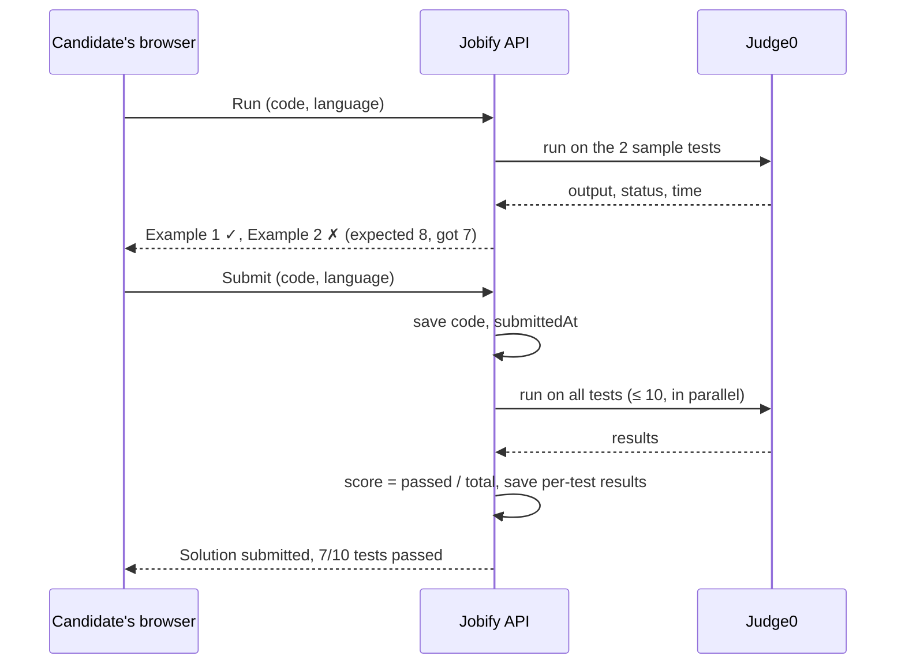

# Coding tests and the code runner

A job's skill test can be a coding problem. Candidates write code in the browser and submit it, and
the hiring team reads it. **Nothing runs the code yet.** This page explains what exists, why there's
no runner, and exactly how [Judge0](https://judge0.com) would plug in to run and grade solutions.

## What exists today

| Part             | What it does                                                                                                                                                           | Where                           |
| ---------------- | ---------------------------------------------------------------------------------------------------------------------------------------------------------------------- | ------------------------------- |
| Problem library  | 30 original problems: 10 easy, 12 medium, 8 hard. Each has a statement, input/output format, constraints, 2 sample tests and hidden tests, **at most 10 tests** in all | `apps/api/src/coding/library`   |
| Test cases       | Expected outputs come from running our own reference solution on each input. Hidden inputs come from a seeded generator, so they're the same on every server           | `library/index.ts` (`getTests`) |
| Output check     | `outputsMatch()`: compares output ignoring trailing spaces and blank lines                                                                                             | `library/index.ts`              |
| Employer setup   | Pick a problem from the library instead of writing a multiple-choice test                                                                                              | `CodingTestSetup.tsx`           |
| Candidate screen | Problem beside a Monaco editor (Python, JavaScript, C++, Java), autosave, timer, submit                                                                                | `CodingExam.tsx`                |
| Review           | The team reads the submitted code (**View code** on the applicants list)                                                                                               | `CodeViewer.tsx`                |

The library lives in code rather than the database, so hidden tests can never reach a browser and the
live site needs no data load. A candidate's language, code and timing are stored on their `Attempt`.

## Why there's no runner yet

Running untrusted code safely needs a sandbox: no network, strict time and memory limits, and no
access to our servers or data. The project rule is that **candidate code never runs inside the API**.

Judge0 is the obvious choice, but none of the ways to use it are free right now:

| Option                         | Cost                                          | Notes                                                                                                                                                        |
| ------------------------------ | --------------------------------------------- | ------------------------------------------------------------------------------------------------------------------------------------------------------------ |
| Judge0 on RapidAPI             | **From $44.99/month** (no free plan any more) | Easiest: an API key and HTTP calls                                                                                                                           |
| Self-hosted Judge0             | Free on a free server, but you run the server | Its sandbox needs Docker in privileged mode and cgroup v1, so it can't run on Render or Vercel. Official images are x86, so check before using an ARM server |
| Run in the candidate's browser | Free                                          | Python (Pyodide) and JavaScript only, and the browser can be tampered with. Fine for a "Run examples" practice button, never for a score                     |

Everything in Jobify runs on free plans, so grading waits until one of these is worth it. The code is
already shaped for it: the tests and the output check exist, and attempts store the code.

## How Judge0 would fit

### What Judge0 does

For each test case we send Judge0 the code, a language id, the test's input and limits. It compiles
and runs the program in its sandbox and returns what happened:

```http
POST /submissions?base64_encoded=true&wait=true
{
  "language_id": 71,
  "source_code": "<base64 code>",
  "stdin": "<base64 test input>",
  "cpu_time_limit": 2,
  "memory_limit": 131072
}
```

```json
{
  "stdout": "<base64 output>",
  "stderr": null,
  "compile_output": null,
  "time": "0.031",
  "memory": 9216,
  "status": { "id": 3, "description": "Accepted" }
}
```

The useful statuses are 3 (finished), 5 (time limit exceeded), 6 (compilation error), 7 to 12
(runtime errors) and 13 (internal error). We compare `stdout` ourselves with `outputsMatch()`
rather than sending the expected output, so the hidden tests' answers never leave the API.

Language ids differ between Judge0 versions: read them once from `GET /languages` and keep the
mapping in config. In Judge0 CE 1.13 they're Python 3 = 71, JavaScript (Node.js) = 63, C++ = 54 and
Java = 62.

### The flow



### What changes in Jobify

1. **A `CodeRunner` interface** in the API with two implementations: `Judge0Runner` (HTTP calls as
   above) and `FakeRunner` for tests, so CI never uses the real service. Without the settings below,
   the runner is off and everything works as today.
2. **Run** (`POST /attempts/:id/run`): runs the code on the **sample tests only** and returns each
   result: passed or failed, the candidate's output, compile or runtime errors. Capped per attempt
   (for example 10 runs) to protect the quota. Results aren't stored.
3. **Submit** grades against **all** tests. It stores `score` (percentage passed) and per-test results
   on the attempt. The candidate sees their score, never the hidden inputs. When time runs out, the
   last autosave is graded the same way.
4. **If Judge0 is down or out of quota**, the code is still saved and submitted. The score shows
   "grading pending", and the worker retries it later, so nobody loses their work.
5. **Screens:** a **Run** button and a results panel on the candidate's screen. For the employer, a
   score on the applicants list (so **Sort by Marks** works like the MCQ) and the per-test results
   in **View code** ("Test 4, hidden: time limit exceeded").
6. **Tests:** the runner's request and response handling with the network mocked; e2e tests with
   `FakeRunner` (samples only on Run, scoring on Submit, hidden tests never returned, the run cap,
   retry when the runner fails); and one manual check against the real Judge0.

### Settings

| Variable         | Example                                                           | Where          |
| ---------------- | ----------------------------------------------------------------- | -------------- |
| `JUDGE0_URL`     | `https://judge0-ce.p.rapidapi.com` or `http://<your-server>:2358` | Render, `.env` |
| `JUDGE0_API_KEY` | RapidAPI key, or the `AUTHN_TOKEN` of a self-hosted server        | Render, `.env` |
| `JUDGE0_HOST`    | `judge0-ce.p.rapidapi.com` (RapidAPI only)                        | Render, `.env` |

RapidAPI sends the key as `X-RapidAPI-Key` and `X-RapidAPI-Host`. A self-hosted server uses
`X-Auth-Token`. Either way, the API is the only thing that calls Judge0: the browser never sees the
key.

### Self-hosting Judge0 (the free route)

On a Linux server you control (x86, at least 2 GB of RAM):

1. Install Docker and Docker Compose.
2. Judge0's sandbox needs cgroup v1. On recent Ubuntu, add `systemd.unified_cgroup_hierarchy=0` to the
   kernel boot options (`GRUB_CMDLINE_LINUX` in `/etc/default/grub`), run `update-grub` and reboot.
3. Download the latest Judge0 CE release from its GitHub page, set passwords and an `AUTHN_TOKEN` in
   `judge0.conf`, then `docker compose up -d db redis`, then `docker compose up -d`.
4. Open port 2358 to the Jobify API only (a firewall rule for Render's outbound addresses), or put it
   behind HTTPS with a reverse proxy.
5. Set `JUDGE0_URL` and `JUDGE0_API_KEY` on Render. Check `GET /languages` once and confirm the ids.

The server then needs the usual care: security updates, restarts and disk space. That upkeep is the
real cost of the free option.
