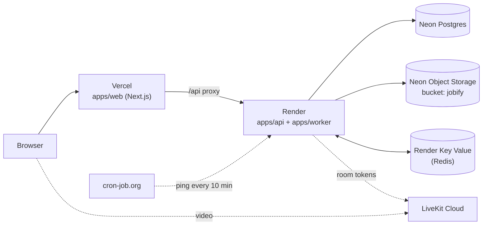

# Deploying Jobify

How Jobify runs in production: which service handles which part, why it was picked, and exactly how
it was set up. Everything runs on **free tiers**.

> **Live:** https://jobify-hire.vercel.app (API: https://jobify-api-g2kn.onrender.com/api/health).
> Every part is set up except the keep-awake ping (section 5). Demo logins: see
> [RUNNING_LOCALLY.md](RUNNING_LOCALLY.md#4-demo-accounts) (password `Password123!`).

## Overview



| Stage                      | Service                        | Why this one                                                                                                      | Status     |
| -------------------------- | ------------------------------ | ----------------------------------------------------------------------------------------------------------------- | ---------- |
| Database                   | **Neon** Postgres              | Managed Postgres with a free plan; pauses when idle; branches for safe experiments                                | ✅ Done    |
| File storage (CVs, photos) | **Neon** Object Storage        | S3-compatible, so the app's storage code works unchanged; same account as the database; no card needed            | ✅ Done    |
| API + background worker    | **Render** (free web service)  | Runs long-lived Node servers, which the API needs for live notifications (Server-Sent Events)                     | ✅ Done    |
| Web app                    | **Vercel** (Hobby)             | Made by the Next.js team; free for personal projects                                                              | ✅ Done    |
| Redis (BullMQ + pub/sub)   | **Render Key Value** (free)    | Same account and region as the API, over Render's private network; no command limit (BullMQ checks Redis all day) | ✅ Done    |
| Video interviews           | **LiveKit Cloud** (Build plan) | Same LiveKit the app uses locally, without the local UDP limits                                                   | ✅ Done    |
| Keep the API awake         | **cron-job.org**               | Render's free tier sleeps after 15 idle minutes; a ping every 10 minutes keeps reminders running                  | ⏳ Planned |

---

## 1. Neon: database and file storage

### Why Neon

- **Postgres, managed and free.** The app is built on Postgres and Prisma; Neon runs it without any
  server to look after. On the free plan the database pauses when idle and wakes in about a second.
- **File storage in the same project.** Neon Object Storage speaks the S3 API, which is what the app
  already uses for SeaweedFS locally. This replaced Cloudflare R2 from the original plan: one fewer
  account, and no card needed.
- **Region close to the users:** AWS Asia Pacific (Singapore), `ap-southeast-1`, the closest
  region to Bangladesh that also has Object Storage.
- **Branches:** a Neon branch is an instant copy of the database _and_ its files, useful for trying
  a migration or for preview deployments later without touching production.

Free-plan limits change over time; check [neon.com/pricing](https://neon.com/pricing).

### What was created

| Item           | Value                                                                       |
| -------------- | --------------------------------------------------------------------------- |
| Region         | AWS Asia Pacific 1 (Singapore), `aws-ap-southeast-1`                        |
| Branch         | `production` (the default branch)                                           |
| Services       | Postgres + Object Storage (chosen in the project wizard)                    |
| Bucket         | `jobify`, **private** (every file is read through a short-lived signed URL) |
| Config in repo | [`neon.ts`](../neon.ts) declares the bucket and the branch policy           |

In the project wizard only **Object storage** was ticked. The other options aren't needed:

| Wizard option  | Picked | Reason                                                               |
| -------------- | ------ | -------------------------------------------------------------------- |
| Better Auth    | No     | Jobify has its own sign-in (argon2, httpOnly cookie sessions, roles) |
| Object storage | Yes    | CVs, profile photos, company logos and covers                        |
| Functions      | No     | The API and worker run on Render                                     |
| AI Gateway     | No     | The app doesn't call AI models (and it needs a paid plan)            |
| Realtime       | No     | Live notifications already go through Redis and Server-Sent Events   |

### How it was set up

**1. Install the Neon CLI**

```bash
npm i -g neon@latest
```

**2. Link the repo to the Neon project and create `neon.ts`**

From the repo root, with the org and project IDs shown in the Neon console:

```bash
neon init -y --org-id <org-id> --project-id <project-id> --branch production \
  --services postgres,object-storage
```

This wrote a git-ignored `.neon` file (which project and branch this folder is linked to) and
`neon.ts`. It also installed Neon's agent skills and plugin for coding assistants.

Two fixes were needed:

- `neon init` failed to add its config package because the repo is a pnpm workspace. Installed it at
  the workspace root instead: `pnpm add -w -D @neon/config`.
- The generated bucket was called `assets`; it was renamed to `jobify` in `neon.ts` to match
  `S3_BUCKET`.

**3. Provision the services**

```bash
neon deploy --no-env-pull
```

```
Applied changes
  + bucket jobify
Utilized services: Postgres, Object Storage
```

`--no-env-pull` stops Neon writing production values into the local `.env`, which must keep
pointing at the Docker services for development and tests.

**4. Save the production values to a separate, git-ignored file**

```bash
neon env pull --file .env.neon
```

`.env.neon` is covered by the `.env.*` rule in `.gitignore`. It contains:

| Neon variable                                | What it is                                                      |
| -------------------------------------------- | --------------------------------------------------------------- |
| `DATABASE_URL`                               | **Pooled** connection (host ends in `-pooler`). Used by the app |
| `DATABASE_URL_UNPOOLED`                      | **Direct** connection. Used by Prisma migrations                |
| `AWS_ENDPOINT_URL_S3`                        | Storage endpoint for the branch                                 |
| `AWS_REGION`                                 | `ap-southeast-1`                                                |
| `AWS_ACCESS_KEY_ID`, `AWS_SECRET_ACCESS_KEY` | Storage credentials                                             |
| `NEON_BRANCH`                                | The branch the values belong to                                 |

Never paste these values into chats, issues or commits. They go only in `.env.neon` and in the
hosting providers' settings.

**5. Wire the app to Neon**

- **Database driver:** the API is a long-running server, so it keeps using node-postgres (Prisma's
  `@prisma/adapter-pg`) on the **pooled** `DATABASE_URL`, as Neon recommends for this kind of host.
- **Migrations:** they fail over the pooled connection (PgBouncer), so
  [`packages/db/prisma.config.ts`](../packages/db/prisma.config.ts) uses `DATABASE_URL_UNPOOLED`
  when it's set and falls back to `DATABASE_URL` locally.
- **Storage:** no code change. The app reads `S3_*` settings, so Neon's values are mapped onto them:

| App setting            | Value                                            |
| ---------------------- | ------------------------------------------------ |
| `S3_ENDPOINT`          | `AWS_ENDPOINT_URL_S3`                            |
| `S3_REGION`            | `AWS_REGION`                                     |
| `S3_BUCKET`            | `jobify`                                         |
| `S3_ACCESS_KEY_ID`     | `AWS_ACCESS_KEY_ID`                              |
| `S3_SECRET_ACCESS_KEY` | `AWS_SECRET_ACCESS_KEY`                          |
| `S3_FORCE_PATH_STYLE`  | `true` (Neon only supports path-style addresses) |

The API doesn't create buckets in production (`NODE_ENV=production`); the bucket comes from `neon.ts`.

**6. Create the tables and load the demo data**

Load `.env.neon` into the shell, map the storage settings, then migrate and seed:

```bash
set -a; . ./.env.neon; set +a
export S3_ENDPOINT="$AWS_ENDPOINT_URL_S3" S3_REGION="$AWS_REGION" S3_BUCKET=jobify \
  S3_ACCESS_KEY_ID="$AWS_ACCESS_KEY_ID" S3_SECRET_ACCESS_KEY="$AWS_SECRET_ACCESS_KEY" \
  S3_FORCE_PATH_STYLE=true
pnpm db:deploy   # 3 migrations, over the direct connection
pnpm db:seed     # demo data; demo CVs are uploaded to the bucket
```

Values exported in the shell take priority over the local `.env`, so this only affects that
terminal. Close it afterwards so later commands don't hit production by accident.

### How it was verified

With the shell from step 6, the production build of the API was started against Neon (local Redis):

```bash
PORT=4100 node apps/api/dist/main.js
```

| Check                                           | Result                                                      |
| ----------------------------------------------- | ----------------------------------------------------------- |
| `pnpm db:deploy`                                | All migrations applied                                      |
| `pnpm db:seed`                                  | 8 companies, 60 jobs, 20 seekers, 53 applications, 18 tests |
| `GET /api/health`                               | `{"status":"ok","database":"up"}`                           |
| Log in as `seeker@jobify.dev`                   | 200                                                         |
| Open the seeded CV                              | Redirect to a signed URL on Neon storage; a valid PDF       |
| Upload a CV (`POST /api/me/cv`) and download it | Same SHA-256 before and after                               |
| Open the file without a session                 | 401                                                         |

The driver prints a warning that `sslmode=require` is treated as `verify-full` (the strictest
check). It's harmless.

### Day-to-day tasks

| Task                        | How                                                                                                |
| --------------------------- | -------------------------------------------------------------------------------------------------- |
| Reset the demo data         | Run step 6 again. `pnpm db:seed` wipes and reloads everything, files included                      |
| Ship a new migration        | Merge it, then run `pnpm db:deploy` from a shell set up as in step 6 (or from the deploy pipeline) |
| Get fresh connection values | `neon env pull --file .env.neon`, then update the hosting providers' settings                      |
| Change Neon services        | Edit `neon.ts`, then `neon deploy --no-env-pull`                                                   |
| Browse production data      | `pnpm db:studio` from a shell set up as in step 6, or the Neon console's SQL editor                |

---

## 2. Render: API, worker and Redis

### Why Render

- The API keeps connections open for live notifications (Server-Sent Events) and the worker runs
  all the time, so both need a host that runs **long-lived Node processes**. Serverless hosts such
  as Vercel Functions stop a request after a time limit.
- The **free web service** runs one always-on process (750 hours a month) and builds straight from
  GitHub on every push to `main`.
- **Render Key Value** (Redis-compatible) has a free plan in the same account and region, reached
  over Render's private network.

### What we use from Render

| Render product    | Used | What for                                                                                          |
| ----------------- | ---- | ------------------------------------------------------------------------------------------------- |
| Web Service       | Yes  | `jobify-api`: the API **and** the worker, free plan                                               |
| Key Value         | Yes  | `jobify-redis`: BullMQ's queue and the notification channel, free plan                            |
| Background Worker | No   | Not on the free plan. The worker runs inside the web service instead (below)                      |
| Postgres          | No   | Neon is the database                                                                              |
| Cron Jobs         | No   | Not on the free plan. The worker schedules its own jobs, and cron-job.org keeps the service awake |
| Static Site       | No   | The web app is on Vercel                                                                          |

**Why the API and worker share one service:** the free plan has no background workers, and two
always-on free services would need about 1,440 hours a month against the 750 allowed. So
[`scripts/start-backend.mjs`](../scripts/start-backend.mjs) starts both as separate programs in one
container. If either one stops, it stops the other and exits, so Render restarts both. Stop
signals from Render reach both, so each finishes its current work before a deploy.

The service is described in [`render.yaml`](../render.yaml) (a Render Blueprint): build and start
commands, region, health check and every setting.

### Key Value (`jobify-redis`)

Created by hand in the dashboard (_New › Key Value_):

| Field            | Value                            | Why                                                                                    |
| ---------------- | -------------------------------- | -------------------------------------------------------------------------------------- |
| Name             | `jobify-redis`                   |                                                                                        |
| Region           | **Singapore**                    | Must match the web service: private networking only works within a region              |
| Maxmemory policy | **`noeviction`**                 | BullMQ requires it. `allkeys-lru` would silently delete queue data when memory is full |
| Plan             | **Free** (25 MB, 50 connections) | The app uses about 5 connections and very little memory                                |
| Persistence      | None (free plan)                 | Nothing durable lives in Redis: the worker recreates its schedule on start             |

Its **Internal Key Value URL** (`redis://red-…:6379`, from the instance's _Connect_ menu) is the
web service's `REDIS_URL`. It only works from Render services in the same region; local development
keeps using Docker Redis.

### Web service (`jobify-api`)

**Create it from the Blueprint:** _New › Blueprint_ → connect the `4K45H107/JOBIFY` repo → Render
reads `render.yaml` and asks for the secret settings:

| Setting                                                | Value                                                                                                                       |
| ------------------------------------------------------ | --------------------------------------------------------------------------------------------------------------------------- |
| `DATABASE_URL`                                         | Neon **pooled** string (`DATABASE_URL` in `.env.neon`)                                                                      |
| `DATABASE_URL_UNPOOLED`                                | Neon **direct** string (used by migrations during the build)                                                                |
| `REDIS_URL`                                            | `jobify-redis`'s Internal Key Value URL                                                                                     |
| `S3_ENDPOINT`                                          | `AWS_ENDPOINT_URL_S3` from `.env.neon`                                                                                      |
| `S3_ACCESS_KEY_ID`, `S3_SECRET_ACCESS_KEY`             | `AWS_ACCESS_KEY_ID`, `AWS_SECRET_ACCESS_KEY` from `.env.neon`                                                               |
| `LIVEKIT_URL`, `LIVEKIT_API_KEY`, `LIVEKIT_API_SECRET` | From the LiveKit Cloud project                                                                                              |
| `WEB_ORIGIN`                                           | The Vercel URL, `https://jobify-hire.vercel.app`. Any valid URL works until Vercel exists; set the real one after section 3 |

These come from `render.yaml` and need no input: `NODE_ENV=production`, `NODE_VERSION=22`,
`TRUST_PROXY=true` (requests pass through Vercel and Render's load balancer), `S3_REGION`,
`S3_BUCKET=jobify`, `S3_FORCE_PATH_STYLE=true`, and `JWT_ACCESS_SECRET`, which Render generates.

What Render then does on every push to `main`:

```bash
# build
corepack pnpm install --frozen-lockfile --prod=false   # devDependencies are needed to build
corepack pnpm turbo run build --filter=@jobify/api --filter=@jobify/worker
corepack pnpm db:deploy   # migrations (no pre-deploy step on the free plan); retried once
# start
node scripts/start-backend.mjs
```

Render waits for `GET /api/health` to answer before sending traffic to a new version.

**Check it:** `https://<service>.onrender.com/api/health` returns `{"status":"ok","database":"up"}`,
and the logs show `[worker] running: interview reminders every minute`.

### What was created

| Item      | Value                                                                                                                          |
| --------- | ------------------------------------------------------------------------------------------------------------------------------ |
| Blueprint | `jobify`, from `render.yaml` on `main`                                                                                         |
| Service   | `jobify-api`, free plan, Singapore: **https://jobify-api-g2kn.onrender.com** (`jobify-api` was taken, so Render added `-g2kn`) |
| Key Value | `jobify-redis`, free plan, Singapore, `noeviction`                                                                             |
| Deploys   | Automatically on every push to `main`                                                                                          |

### How it was verified

Before deploying, the exact build and start commands were run in a fresh clone with
`NODE_ENV=production`, against Neon and a local Redis:

- install, build and migrations succeeded. The first migration attempt failed once while Neon was
  waking up, which is why the build retries it.
- `/api/health` answered `database: up` and the worker logged its schedule.
- `SIGTERM` stopped both programs cleanly and the script exited.
- When one program failed to start, the script stopped the other and exited.

After deploying: the first build succeeded, `/api/health` returned `database: up`, demo logins work,
and the worker sent a live interview reminder (see [End-to-end check](#end-to-end-check-of-the-live-site)).

## 3. Vercel: web app

### Why Vercel

Vercel is made by the Next.js team and runs the web app with no configuration; the Hobby plan is
free for personal projects. The browser only talks to Vercel: `/api/*` is proxied to Render, so the
login cookies stay on the web app's own domain.

### How to set it up

_Add New › Project_ → import `4K45H107/JOBIFY`. Vercel detects both `apps/api` (NestJS) and
`apps/web` and offers to deploy them together as "Services": **don't**. The API runs on Render; on
Vercel it would become short-lived functions, which breaks live notifications and can't run the
worker. Instead set:

| Setting                    | Value                                                                          |
| -------------------------- | ------------------------------------------------------------------------------ |
| Root Directory             | `apps/web`                                                                     |
| Framework                  | Next.js (detected)                                                             |
| Build and install commands | Leave as they are: [`apps/web/vercel.json`](../apps/web/vercel.json) sets them |
| Environment variable       | `API_URL` = `https://jobify-api-g2kn.onrender.com` (no trailing slash)         |

`API_URL` is baked into the build (it's where `/api` is proxied), so after changing it, **redeploy**.
Then set `WEB_ORIGIN` on Render to the Vercel URL.

`vercel.json` installs the whole workspace and builds the web app with its shared package
(`turbo run build --filter=@jobify/web`). This was checked in a fresh clone with only `API_URL` set.

### What was created

| Item    | Value                                                                                                                                                                  |
| ------- | ---------------------------------------------------------------------------------------------------------------------------------------------------------------------- |
| Project | `jobify`, Hobby plan, from `main`                                                                                                                                      |
| Domain  | **https://jobify-hire.vercel.app**, added under _Settings › Domains_ (free `vercel.app` name; the project also keeps Vercel's generated `jobify-sandy-six.vercel.app`) |
| Deploys | Production on every push to `main`; a preview build for every pull request (shown as a PR check)                                                                       |

After the domain was chosen, `WEB_ORIGIN` on Render was set to `https://jobify-hire.vercel.app`.

### Server time zone

Vercel renders pages on servers in **UTC**, while visitors see their own time zone. Text that
depends on the viewer's clock, time zone or locale (interview times, "3h ago", countdowns) is
therefore filled in only in the browser, through `ClientTime` and `useHydrated`
(`apps/web/src/components/ui/ClientTime.tsx`). Rendering it on the server too caused React
hydration errors on the interview pages (fixed in PR #30).

## 4. LiveKit Cloud: video interviews

### Why LiveKit Cloud

The app already uses LiveKit (a local server in Docker for development). LiveKit Cloud is the hosted
version: no server to run, no UDP or firewall issues, and a free Build plan. The API only creates
short-lived room tokens with the API key and secret; browsers connect to LiveKit directly.

### How it was set up

1. Signed up at [cloud.livekit.io](https://cloud.livekit.io) and created the project `jobify`. The
   onboarding questions are optional (answered "Web app" and "Video conferencing").
2. **Region: Europe.** Only US and Europe were offered; Europe is closer to Bangladesh. Calls are
   still routed through LiveKit's nearest edge servers.
3. **Agent observability: off.** It records LiveKit Agents (AI bots) sessions; Jobify has none, and
   leaving it off avoids storing interview data.
4. _Settings › API keys › Create key_. The **secret is shown only once**: copy it before closing
   the dialog. (The first key's secret was lost, so it was revoked and a new key created.)
5. Put the three values on Render (`jobify-api` › Environment):

| Setting              | Value                                 |
| -------------------- | ------------------------------------- |
| `LIVEKIT_URL`        | `wss://jobify-bxha3jvq.livekit.cloud` |
| `LIVEKIT_API_KEY`    | the key (`API…`)                      |
| `LIVEKIT_API_SECRET` | the secret                            |

Nothing else is needed from LiveKit: no Agents, telephony, Egress or recording.

### How it was verified

- Before putting the key on Render, it was checked against LiveKit's server API: creating, listing
  and deleting a room all succeeded (they fail with a wrong key or secret).
- On the live site, the seeker and the employer each got a join token for the same room, on the
  `wss://jobify-bxha3jvq.livekit.cloud` URL, signed with the new key.
- In the dashboard, _Sessions_ lists the rooms that were actually joined.

## 5. cron-job.org: keep the API awake

### Why

Render's free web service sleeps after 15 minutes without traffic. While it sleeps, the worker
inside it stops too, so interview reminders would be missed, and the next visitor waits about a
minute for it to wake up. A ping every 10 minutes keeps it awake. One service running all month is
about 744 hours, within the free 750.

### How to set it up

[cron-job.org](https://cron-job.org) (free) → _Create cronjob_:

| Field    | Value                                             |
| -------- | ------------------------------------------------- |
| URL      | `https://jobify-api-g2kn.onrender.com/api/health` |
| Schedule | Every 10 minutes                                  |

Check it under the job's history: each run should be `200`.

_Status: to do._

---

## End-to-end check of the live site

Run against https://jobify-hire.vercel.app after everything was deployed:

| Check                                  | Result                                                                                                                       |
| -------------------------------------- | ---------------------------------------------------------------------------------------------------------------------------- |
| Open `/` signed out                    | Redirects to `/login`                                                                                                        |
| `/api/health` through the Vercel proxy | `{"status":"ok","database":"up"}`                                                                                            |
| Sign in as seeker and as employer      | 200; Chrome shows Home with "For you" jobs, 60 jobs and 8 companies                                                          |
| Upload a CV, then open it              | 201, then a redirect to a signed Neon Storage URL; the downloaded file is byte-identical; 401 without a session              |
| Live notification                      | The employer schedules an interview; the seeker's open stream receives "Interview scheduled" about 2 s later, through Vercel |
| Worker                                 | The seeker's stream also receives "Interview starting soon" from the worker on Render                                        |
| Video room                             | Seeker and employer get tokens for the same LiveKit room                                                                     |
| Times                                  | No hydration errors with a UTC server and a browser in Asia/Dhaka (after PR #30)                                             |

The test interviews were cancelled afterwards. To reset all demo data, see
[Day-to-day tasks](#day-to-day-tasks) in the Neon section.

## Where the settings live

All production values are kept in the git-ignored `.env.production` on the owner's machine (and in
a password manager), and in each provider's dashboard. Nothing secret is committed.
