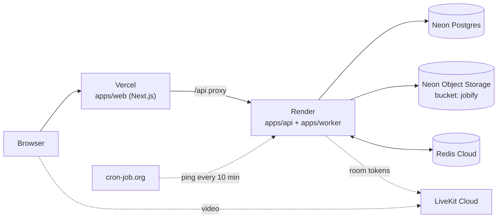

# Deploying Jobify

How Jobify runs in production: which service handles which part, why it was picked, and exactly how
it was set up. Everything runs on **free tiers**.

> Status: **Neon (database + file storage) is set up.** The other services are planned and will be
> filled in here as each one is set up.

## Overview



| Stage                      | Service                        | Why this one                                                                                                    | Status     |
| -------------------------- | ------------------------------ | --------------------------------------------------------------------------------------------------------------- | ---------- |
| Database                   | **Neon** Postgres              | Managed Postgres with a free plan; pauses when idle; branches for safe experiments                              | ✅ Done    |
| File storage (CVs, photos) | **Neon** Object Storage        | S3-compatible, so the app's storage code works unchanged; same account as the database; no card needed          | ✅ Done    |
| API + background worker    | **Render** (free web service)  | Runs long-lived Node servers, which the API needs for live notifications (Server-Sent Events)                   | ⏳ Planned |
| Web app                    | **Vercel** (Hobby)             | Made by the Next.js team; free for personal projects                                                            | ⏳ Planned |
| Redis (BullMQ + pub/sub)   | **Redis Cloud** (free)         | No limit on commands. BullMQ checks Redis all day, which would use up a per-command free plan such as Upstash's | ⏳ Planned |
| Video interviews           | **LiveKit Cloud** (Build plan) | Same LiveKit the app uses locally, without the local UDP limits                                                 | ⏳ Planned |
| Keep the API awake         | **cron-job.org**               | Render's free tier sleeps after 15 idle minutes; a ping every 10 minutes keeps reminders running                | ⏳ Planned |

---

## 1. Neon: database and file storage

### Why Neon

- **Postgres, managed and free.** The app is built on Postgres and Prisma; Neon runs it without any
  server to look after. On the free plan the database pauses when idle and wakes in about a second.
- **File storage in the same project.** Neon Object Storage speaks the S3 API, which is what the app
  already uses for SeaweedFS locally. This replaced Cloudflare R2 from the original plan: one fewer
  account, and no card needed.
- **Region close to the users:** AWS Asia Pacific (Singapore), `ap-southeast-1`, the closest
  region to Bangladesh that also has Object Storage.
- **Branches:** a Neon branch is an instant copy of the database _and_ its files, useful for trying
  a migration or for preview deployments later without touching production.

Free-plan limits change over time; check [neon.com/pricing](https://neon.com/pricing).

### What was created

| Item           | Value                                                                       |
| -------------- | --------------------------------------------------------------------------- |
| Region         | AWS Asia Pacific 1 (Singapore), `aws-ap-southeast-1`                        |
| Branch         | `production` (the default branch)                                           |
| Services       | Postgres + Object Storage (chosen in the project wizard)                    |
| Bucket         | `jobify`, **private** (every file is read through a short-lived signed URL) |
| Config in repo | [`neon.ts`](../neon.ts) declares the bucket and the branch policy           |

In the project wizard only **Object storage** was ticked. The other options aren't needed:

| Wizard option  | Picked | Reason                                                               |
| -------------- | ------ | -------------------------------------------------------------------- |
| Better Auth    | No     | Jobify has its own sign-in (argon2, httpOnly cookie sessions, roles) |
| Object storage | Yes    | CVs, profile photos, company logos and covers                        |
| Functions      | No     | The API and worker run on Render                                     |
| AI Gateway     | No     | The app doesn't call AI models (and it needs a paid plan)            |
| Realtime       | No     | Live notifications already go through Redis and Server-Sent Events   |

### How it was set up

**1. Install the Neon CLI**

```bash
npm i -g neon@latest
```

**2. Link the repo to the Neon project and create `neon.ts`**

From the repo root, with the org and project IDs shown in the Neon console:

```bash
neon init -y --org-id <org-id> --project-id <project-id> --branch production \
  --services postgres,object-storage
```

This wrote a git-ignored `.neon` file (which project and branch this folder is linked to) and
`neon.ts`. It also installed Neon's agent skills and plugin for coding assistants.

Two fixes were needed:

- `neon init` failed to add its config package because the repo is a pnpm workspace. Installed it at
  the workspace root instead: `pnpm add -w -D @neon/config`.
- The generated bucket was called `assets`; it was renamed to `jobify` in `neon.ts` to match
  `S3_BUCKET`.

**3. Provision the services**

```bash
neon deploy --no-env-pull
```

```
Applied changes
  + bucket jobify
Utilized services: Postgres, Object Storage
```

`--no-env-pull` stops Neon writing production values into the local `.env`, which must keep
pointing at the Docker services for development and tests.

**4. Save the production values to a separate, git-ignored file**

```bash
neon env pull --file .env.neon
```

`.env.neon` is covered by the `.env.*` rule in `.gitignore`. It contains:

| Neon variable                                | What it is                                                      |
| -------------------------------------------- | --------------------------------------------------------------- |
| `DATABASE_URL`                               | **Pooled** connection (host ends in `-pooler`). Used by the app |
| `DATABASE_URL_UNPOOLED`                      | **Direct** connection. Used by Prisma migrations                |
| `AWS_ENDPOINT_URL_S3`                        | Storage endpoint for the branch                                 |
| `AWS_REGION`                                 | `ap-southeast-1`                                                |
| `AWS_ACCESS_KEY_ID`, `AWS_SECRET_ACCESS_KEY` | Storage credentials                                             |
| `NEON_BRANCH`                                | The branch the values belong to                                 |

Never paste these values into chats, issues or commits. They go only in `.env.neon` and in the
hosting providers' settings.

**5. Wire the app to Neon**

- **Database driver:** the API is a long-running server, so it keeps using node-postgres (Prisma's
  `@prisma/adapter-pg`) on the **pooled** `DATABASE_URL`, as Neon recommends for this kind of host.
- **Migrations:** they fail over the pooled connection (PgBouncer), so
  [`packages/db/prisma.config.ts`](../packages/db/prisma.config.ts) uses `DATABASE_URL_UNPOOLED`
  when it's set and falls back to `DATABASE_URL` locally.
- **Storage:** no code change. The app reads `S3_*` settings, so Neon's values are mapped onto them:

| App setting            | Value                                            |
| ---------------------- | ------------------------------------------------ |
| `S3_ENDPOINT`          | `AWS_ENDPOINT_URL_S3`                            |
| `S3_REGION`            | `AWS_REGION`                                     |
| `S3_BUCKET`            | `jobify`                                         |
| `S3_ACCESS_KEY_ID`     | `AWS_ACCESS_KEY_ID`                              |
| `S3_SECRET_ACCESS_KEY` | `AWS_SECRET_ACCESS_KEY`                          |
| `S3_FORCE_PATH_STYLE`  | `true` (Neon only supports path-style addresses) |

The API doesn't create buckets in production (`NODE_ENV=production`); the bucket comes from `neon.ts`.

**6. Create the tables and load the demo data**

Load `.env.neon` into the shell, map the storage settings, then migrate and seed:

```bash
set -a; . ./.env.neon; set +a
export S3_ENDPOINT="$AWS_ENDPOINT_URL_S3" S3_REGION="$AWS_REGION" S3_BUCKET=jobify \
  S3_ACCESS_KEY_ID="$AWS_ACCESS_KEY_ID" S3_SECRET_ACCESS_KEY="$AWS_SECRET_ACCESS_KEY" \
  S3_FORCE_PATH_STYLE=true
pnpm db:deploy   # 3 migrations, over the direct connection
pnpm db:seed     # demo data; demo CVs are uploaded to the bucket
```

Values exported in the shell take priority over the local `.env`, so this only affects that
terminal. Close it afterwards so later commands don't hit production by accident.

### How it was verified

With the shell from step 6, the production build of the API was started against Neon (local Redis):

```bash
PORT=4100 node apps/api/dist/main.js
```

| Check                                           | Result                                                      |
| ----------------------------------------------- | ----------------------------------------------------------- |
| `pnpm db:deploy`                                | All migrations applied                                      |
| `pnpm db:seed`                                  | 8 companies, 60 jobs, 20 seekers, 53 applications, 18 tests |
| `GET /api/health`                               | `{"status":"ok","database":"up"}`                           |
| Log in as `seeker@jobify.dev`                   | 200                                                         |
| Open the seeded CV                              | Redirect to a signed URL on Neon storage; a valid PDF       |
| Upload a CV (`POST /api/me/cv`) and download it | Same SHA-256 before and after                               |
| Open the file without a session                 | 401                                                         |

The driver prints a warning that `sslmode=require` is treated as `verify-full` (the strictest
check). It's harmless.

### Day-to-day tasks

| Task                        | How                                                                                                |
| --------------------------- | -------------------------------------------------------------------------------------------------- |
| Reset the demo data         | Run step 6 again. `pnpm db:seed` wipes and reloads everything, files included                      |
| Ship a new migration        | Merge it, then run `pnpm db:deploy` from a shell set up as in step 6 (or from the deploy pipeline) |
| Get fresh connection values | `neon env pull --file .env.neon`, then update the hosting providers' settings                      |
| Change Neon services        | Edit `neon.ts`, then `neon deploy --no-env-pull`                                                   |
| Browse production data      | `pnpm db:studio` from a shell set up as in step 6, or the Neon console's SQL editor                |

---

## 2. Render: API and worker

_Not set up yet._

## 3. Vercel: web app

_Not set up yet._

## 4. Redis Cloud

_Not set up yet._

## 5. LiveKit Cloud

_Not set up yet._

## 6. cron-job.org: keep the API awake

_Not set up yet._
