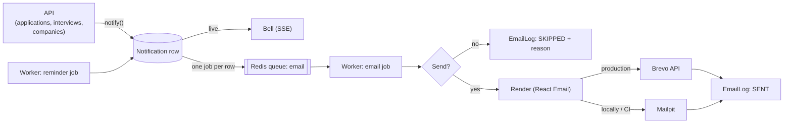

# Email notifications

How Jobify sends email: what goes out, to whom, how it's built, how to run it locally and in
production, and what's left to do.

> **Status:** built, deployed (PR #39) and **on in production** through Brevo since 2 Nov 2026.
> Locally every email goes to Mailpit. Remaining items: [What's left](#whats-left).

## What gets sent

Every email mirrors an in-app notification (the bell), with the same title and text.

| Who                 | Email                                                                         | Settings switch        | Sent when                                      |
| ------------------- | ----------------------------------------------------------------------------- | ---------------------- | ---------------------------------------------- |
| Seeker              | Application update (shortlisted, test, interview, offer, rejected, withdrawn) | Application updates    | An employer moves the application              |
| Seeker              | Skill test for _job_                                                          | Skill tests            | Applying to a job that has a test              |
| Seeker              | Interview scheduled / rescheduled / cancelled, with time                      | Interview schedule     | The employer schedules or changes an interview |
| Seeker and employer | Interview starting soon, with time                                            | Interview reminders    | 15 minutes before the start (the worker)       |
| Employer            | New applicant for _job_                                                       | New applicants         | Someone applies to a job they posted           |
| Company admin       | Join request                                                                  | Join requests          | Someone asks to join the company               |
| Employer            | Welcome to _company_ / Join request declined                                  | Join request decisions | The company admin decides                      |

Every email has a **Jobify header**, a greeting, the message, a button to the right page, and a
footer with **Email settings** and **Unsubscribe from these** links.

## How it works



1. **Queue.** When the API (or the worker's reminder job) creates a notification, it also adds an
   `email` job with the notification id. The API only queues; a slow or failing email provider
   never holds up a click. Queuing never throws: without Redis nothing is queued.
2. **Decide.** The worker sends only if all of these hold, and otherwise logs `SKIPPED` with the
   reason:
   - email is on (`EMAIL_ENABLED`, and in production `BREVO_API_KEY` is set)
   - the type is one this role gets (table above)
   - the person hasn't turned that type off in Settings
   - it isn't a **demo account** while the provider is real (Brevo)
3. **Claim.** It creates the notification's `EmailLog` row (unique per notification) as `SENDING`.
   A duplicate job or a second worker finds the row and stops, so **nobody gets the same email
   twice**.
4. **Render and send.** Brevo in production, SMTP to Mailpit locally. Then the row becomes `SENT`
   with the provider's message id.
5. **Retry.** A failed send throws; BullMQ tries again after 30 s and after 1 min. After the third
   failure the row becomes `FAILED` with the error.

### Why demo accounts are protected

**Seeded accounts** are the made-up users the seed script (`pnpm db:seed`) creates so the app isn't
empty: the demo logins plus about 35 random people, with companies, jobs and applications. They
stay in the app next to real users. But their addresses are invented, and some are on real
providers (`…@gmail.com`, `…@hotmail.com`), so they could belong to real strangers.

Every seeded user is marked `isDemo`, and the worker never emails them through Brevo. Locally they
still get email in Mailpit, so the demo flows show emails. Accounts people register themselves are
never demo.

**Don't run `pnpm db:seed` against the live database:** it wipes every table, real users included,
before recreating the demo data. Reseeding is only for local development.

## Where the code is

| Part                            | Location                                                                                                      |
| ------------------------------- | ------------------------------------------------------------------------------------------------------------- |
| Template                        | [`packages/email/src/templates/NotificationEmail.tsx`](../packages/email/src/templates/NotificationEmail.tsx) |
| Rendering (text, links, time)   | [`packages/email/src/render.ts`](../packages/email/src/render.ts)                                             |
| Brevo and SMTP senders          | [`packages/email/src/transport.ts`](../packages/email/src/transport.ts)                                       |
| Unsubscribe tokens              | [`packages/email/src/tokens.ts`](../packages/email/src/tokens.ts)                                             |
| Email job (decide, claim, send) | [`apps/worker/src/email.ts`](../apps/worker/src/email.ts)                                                     |
| Queuing from the API            | [`apps/api/src/email/email-queue.service.ts`](../apps/api/src/email/email-queue.service.ts)                   |
| Preferences, unsubscribe        | [`apps/api/src/email/`](../apps/api/src/email/)                                                               |
| Email types per role            | [`packages/shared/src/email.ts`](../packages/shared/src/email.ts) (`EMAIL_TYPES`)                             |
| Wording (shared with the bell)  | `describeNotification` in [`packages/shared/src/notification.ts`](../packages/shared/src/notification.ts)     |
| Settings page                   | [`EmailPreferencesSection.tsx`](../apps/web/src/components/profile/EmailPreferencesSection.tsx)               |
| Unsubscribe page                | [`apps/web/src/app/(auth)/unsubscribe`](<../apps/web/src/app/(auth)/unsubscribe>)                             |

### Database

| Table             | What it holds                                                                                                         |
| ----------------- | --------------------------------------------------------------------------------------------------------------------- |
| `EmailPreference` | One row per user and type the user changed. **No row means on.**                                                      |
| `EmailLog`        | One row per notification's email: `SENDING`, `SENT`, `SKIPPED` or `FAILED`, the reason, and the provider's message id |
| `User.isDemo`     | Seeded demo account: never emailed through a real provider                                                            |

### API

| Endpoint                        | Who       | What                                                                                        |
| ------------------------------- | --------- | ------------------------------------------------------------------------------------------- |
| `GET /api/me/email-preferences` | Signed in | The role's email types, each on or off                                                      |
| `PUT /api/me/email-preferences` | Signed in | `{ preferences: [{ type, enabled }] }`; other roles' types are rejected                     |
| `POST /api/email/unsubscribe`   | Anyone    | Turns one type off. Token in the body, or in `?token=` for mail apps' one-click unsubscribe |

## Unsubscribe

- The footer link opens `/unsubscribe?token=…`, which works **signed in or not**. It unsubscribes
  on a **button press**, not on page load, because mail systems' link scanners open links.
- Emails also carry the `List-Unsubscribe` and `List-Unsubscribe-Post` headers (RFC 8058), so
  Gmail and Apple Mail show their own **Unsubscribe** button, which posts straight to the API.
- The token is `userId.type.signature`: an HMAC keyed with `JWT_ACCESS_SECRET`, so a link can't be
  forged or changed to another person or type. It doesn't expire, so old emails keep working.
- Unsubscribing turns off **that type only**; everything stays visible under the bell, and
  Settings can turn it back on.

## Settings

| Setting             | Where           | Default                          | What                                                                |
| ------------------- | --------------- | -------------------------------- | ------------------------------------------------------------------- |
| `EMAIL_ENABLED`     | worker          | `true`                           | Kill switch for all email                                           |
| `BREVO_API_KEY`     | worker (secret) | unset                            | Set: send through Brevo. Unset: SMTP locally, **off** in production |
| `MAIL_FROM`         | worker          | `Jobify <no-reply@jobify.local>` | Sender; in production a sender verified in Brevo                    |
| `SMTP_URL`          | worker          | `smtp://localhost:1025`          | Mailpit locally and in CI                                           |
| `EMAIL_TIME_ZONE`   | worker          | `Asia/Dhaka`                     | Interview times are shown in this zone, named ("GMT+6")             |
| `WEB_ORIGIN`        | worker, API     | `http://localhost:3000`          | Base of every link in an email                                      |
| `JWT_ACCESS_SECRET` | worker, API     | (required)                       | Signs and checks unsubscribe links (same value in both)             |

On Render the API and worker share one service, so they share these values.

## Running it locally

```bash
pnpm services:up   # includes Mailpit
pnpm db:deploy     # email tables
pnpm dev
```

Open **http://localhost:8025** to see every email the app sends. Nothing leaves your machine. Try:
sign in as `employer@jobify.dev`, schedule an interview for a shortlisted applicant, and the
seeker's "Interview scheduled" email appears within a couple of seconds.

## Production (Brevo)

Brevo's free plan sends about 300 emails a day and needs no domain. Setup steps are in
[DEPLOYMENT.md › Brevo](DEPLOYMENT.md#5-brevo-email).

Checking it:

- The worker's start-up log line says `emails via brevo` (or `off: BREVO_API_KEY not set`).
- Brevo's **Transactional › Logs** lists every email sent.
- The `EmailLog` table (Neon SQL editor) shows sent, skipped and failed emails with reasons:
  ```sql
  SELECT "createdAt", "to", type, status, reason FROM "EmailLog" ORDER BY "createdAt" DESC LIMIT 20;
  ```

## Tests

| Where            | What                                                                                                                                                                                                                          |
| ---------------- | ----------------------------------------------------------------------------------------------------------------------------------------------------------------------------------------------------------------------------- |
| `packages/email` | Rendering (links, footer, escaping, interview time, cancellation), tokens (round trip, tampering, wrong secret), the Brevo request and errors                                                                                 |
| `apps/worker`    | Against the real database: sends once, two workers racing send one email, skips for settings / demo / role / kill switch, retry after a failure, the final failure, and **real delivery over SMTP into Mailpit** with headers |
| `apps/api`       | Preferences (defaults, saving, role check), unsubscribe by body and query string without a session, forged and missing tokens, a new notification queuing an email job                                                        |
| `apps/web`       | The settings switch (saves, reverts on failure), the unsubscribe route rule                                                                                                                                                   |

## Troubleshooting

| Problem                             | Check                                                                                                                    |
| ----------------------------------- | ------------------------------------------------------------------------------------------------------------------------ |
| No email in Mailpit                 | Is the worker running (`pnpm dev`)? Is Mailpit up (`pnpm services:up`)? Look at `EmailLog` for a `SKIPPED` reason        |
| Production sends nothing            | Worker log says `off: BREVO_API_KEY not set`? Set the key and `MAIL_FROM` on Render                                      |
| Email to a demo account wasn't sent | Expected in production: demo accounts are skipped. Use an account you registered                                         |
| `FAILED` with "Brevo 401"           | Wrong, revoked or **expired** API key (see Known limitations). Generate a new one and replace `BREVO_API_KEY` on Render  |
| `FAILED` with "Brevo 400 … sender"  | `MAIL_FROM` isn't a sender verified in Brevo                                                                             |
| Emails land in spam                 | Mark one "Not spam". Brevo already sends a Gmail sender from its own domain (see below); a domain of your own helps most |
| An email came twice                 | Shouldn't happen: `EmailLog` is unique per notification. Check for two notification rows                                 |

## Known limitations

- **Sender address:** Gmail is a free provider, so Brevo rewrites the sender onto its own domain
  (e.g. `fahad11.ahmed11@12650113.brevosend.com`) to pass Gmail's sender checks
  (SPF/DKIM/DMARC). The name "Jobify" still shows, and the first real test landed in the inbox. A
  domain of your own, verified in Brevo, would make the address match exactly.
- **One time zone:** everyone sees interview times in `EMAIL_TIME_ZONE`, with the zone named.
- **Free-tier sleep:** the worker sleeps with the API after 15 idle minutes; a reminder due while
  nobody uses the site isn't sent then. See
  [Known limitations](DEPLOYMENT.md#6-known-limitations-sleeping-on-the-free-tier).
- **300 emails a day** on Brevo's free plan; plenty for a demo.
- **The API key expires:** the current one on **2 Nov 2027**, and Brevo also expires keys after
  **90 days without use**. If the demo sends no email for three months, emails start failing with
  "Brevo 401": generate a new key (Restricted, _Transactional email: All_, everything else _None_)
  and replace `BREVO_API_KEY` on Render.

## What's left

**Owner (to turn real email on):**

- [x] **Mark the seeded accounts as demo on Neon** (done 2 Nov 2026: 38 demo accounts, 1 real).
- [x] **Brevo account** (free plan) at brevo.com.
- [x] **Verify a sender:** _Settings › Senders, domains & dedicated IPs › Senders › Add a sender_
      (name `Jobify`, your Gmail), then click the confirmation link Brevo emails you.
- [x] **API key** (Restricted: _Transactional email: All_, everything else _None_; a test email
      through it was accepted on 2 Nov 2026): _Settings › SMTP & API › API keys › Generate a new API key_. Copy it right away.
- [x] **Render** (`jobify-api` › Environment): `BREVO_API_KEY` and `MAIL_FROM` set and deployed
      (2 Nov 2026).
- [x] **Live check:** an interview scheduled for the demo seeker on the live site was logged
      `SKIPPED: Demo account`, which only happens with Brevo active, so the worker runs, uses Brevo,
      and protects demo accounts.
- [ ] **A real email from the live app to your own account:** as `fahad11.ahmed11@gmail.com` (a
      seeker), Easy Apply to a Northwind job marked "Includes a skill test". "Skill test for …" should
      arrive within seconds; the `EmailLog` query above should show `SENT`.

**Code (not started):**

- [ ] **"Application received" email to the seeker.** Applying notifies only the employer today,
      so the seeker gets no confirmation. Needs a new notification type and Settings switch.
- [ ] **Job-alert emails:** come with the job alerts feature (Batch 4).
- [ ] **Automated end-to-end check** of an email in Mailpit (with the Playwright setup, Batch 1).

**Optional later:**

- [ ] A domain of your own, verified in Brevo (SPF/DKIM), so the sender address is your own.
- [ ] Each person's own time zone for interview times.
