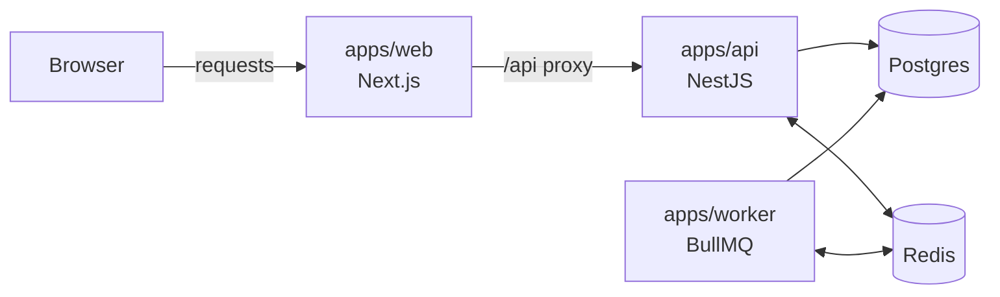
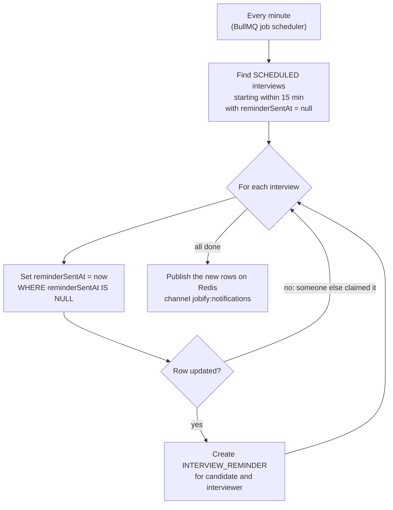
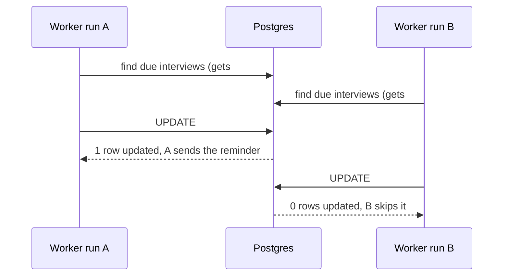
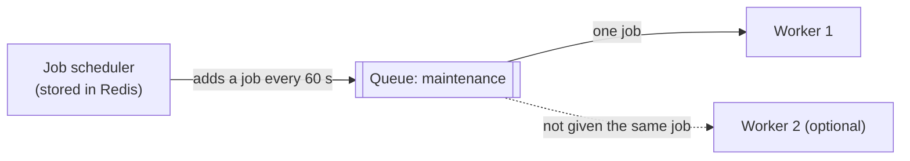
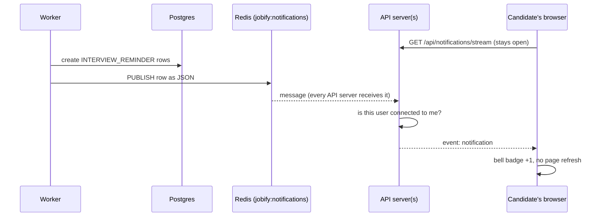

# The background worker (`apps/worker`)

`apps/worker` is a separate background program that runs alongside the web app and the API.
Right now it has one job: **reminding both people shortly before an interview starts**. Job-alert
digests and emails will move here later.

- Code: [`apps/worker/src`](../apps/worker/src)
- Started by `pnpm dev`. On its own: `pnpm --filter @jobify/worker dev`.
- Needs `DATABASE_URL` and `REDIS_URL` (see `.env.example`).

## Why it's a separate program

The API only does something when someone sends it a request (opening a page, clicking Apply). A
reminder has to go out **at a certain time, even when nobody is using the app**, so something has to
keep checking the clock. That's the worker.



Keeping it apart from the API means:

- slow or scheduled work never slows down page loads
- the API and the worker can be restarted, deployed and scaled independently
- the worker serves no web pages, so it can't be reached from the internet

## What it does: interview reminders

Code: [`reminders.ts`](../apps/worker/src/reminders.ts). **Every minute** it:

1. **Finds** interviews that are `SCHEDULED`, start within the next **15 minutes**
   (`REMINDER_LEAD_MS`), and have no `reminderSentAt` yet.
2. **Claims** each one by setting `reminderSentAt`, but only if it's still empty. If another worker
   or an overlapping run got there first, the update changes nothing and this run skips it, so
   **nobody gets two reminders**.
3. **Creates** an `INTERVIEW_REMINDER` notification for the **candidate** and the **interviewer**.
4. After the loop, **publishes** all the new notifications so open browser tabs update straight away
   (see [delivery](#how-a-reminder-reaches-the-browser)).



Rescheduling an interview clears `reminderSentAt` (in the API), so the new time gets its own
reminder.

### Why the claim step matters

Two workers, or a run that overlaps the next one, can both find the same interview. The claim is a
single compare-and-set `UPDATE … WHERE reminderSentAt IS NULL`. Postgres lets exactly one of them
change the row:



## What BullMQ does here

[BullMQ](https://docs.bullmq.io) is a job-queue library that stores its jobs in Redis. The worker
uses it for the "every minute" part ([`main.ts`](../apps/worker/src/main.ts)):

```ts
await queue.upsertJobScheduler(
  "interview-reminders",
  { every: 60_000 },
  { name: "interview-reminders" },
);
```

Because the schedule lives in **Redis**, not in the program's memory, BullMQ makes sure **each
tick runs once** even if you start several workers. A plain `setInterval` in each program couldn't
guarantee that: every copy would fire. BullMQ also records failures, so a crashed run shows up in
the logs instead of disappearing.



## How a reminder reaches the browser

The worker can't talk to browsers itself. Only the API keeps live connections open, using
Server-Sent Events. So the worker **publishes** each new notification on a Redis channel, and
**every API server listens** to that channel and forwards it to the right person's open tab.



The API sends **its own** notifications (new applicant, shortlisted, interview scheduled) the same
way. That's why live notifications still work when production runs **several API servers**: whichever
server the user is connected to receives the message.

The shared pieces live in `@jobify/shared`: `NOTIFICATIONS_CHANNEL` and `notificationRowSchema`,
the message shape that both sides validate.

## Running and deploying

| Where      | How                                                                                                                                                                |
| ---------- | ------------------------------------------------------------------------------------------------------------------------------------------------------------------ |
| Local      | `pnpm dev` starts it with the web app and API. Look for `[worker] running: interview reminders every minute`                                                       |
| Production | Its own small service: `pnpm --filter @jobify/worker build` then `pnpm --filter @jobify/worker start`, with `DATABASE_URL` and `REDIS_URL`. No port, no public URL |
| Tests      | `pnpm --filter @jobify/worker test`: runs the reminder logic against the real database (needs `pnpm services:up`)                                                  |

It stops cleanly on `SIGTERM`/`SIGINT` (finishes the current job, closes connections), which is
what hosting platforms send on deploys.

## What it will do next

The plan (Phase 5) assigns these jobs to the worker, because they're also scheduled or slow:

- **Job alerts:** a daily digest of new jobs matching a seeker's saved searches.
- **Emails:** "application received", "interview scheduled" and reminder emails, with automatic
  retries if the email provider is down. A slow email service then never holds up a click in the
  app.

---

## Alternatives we could have used

Different ways to get the same result ("tell both people 15 minutes before"), and why this setup
was picked.

| Option                                                                                                                        | How it would work                                                     | Good                                                                              | Not so good                                                                                                     |
| ----------------------------------------------------------------------------------------------------------------------------- | --------------------------------------------------------------------- | --------------------------------------------------------------------------------- | --------------------------------------------------------------------------------------------------------------- |
| **`setInterval` / `node-cron` inside the API**                                                                                | A timer in the API process checks every minute                        | Simplest; no extra program                                                        | Every API copy fires (duplicates without the claim step); slows the API; restarts lose the timer                |
| **OS cron / Kubernetes CronJob / platform cron** (e.g. Railway cron, Vercel Cron)                                             | The platform starts a short script every minute                       | No always-on process; nothing to run in between                                   | Minute-level only; cold start each run; ties the app to one host's scheduler; no retries or job history         |
| **BullMQ delayed jobs** (instead of polling)                                                                                  | When an interview is scheduled, add a job delayed until 15 min before | Exact timing, no polling query                                                    | Every reschedule or cancel must also find and remove the old job; jobs and database can drift apart             |
| **Postgres-based queues: [pg-boss](https://github.com/timgit/pg-boss), [Graphile Worker](https://worker.graphile.org)**       | The job queue lives in Postgres tables                                | No Redis needed for jobs; jobs can be created in the same transaction as the data | We already need Redis for live notifications, so it doesn't save a service; puts more load on the main database |
| **[Agenda](https://github.com/agenda/agenda)**                                                                                | Scheduler stored in MongoDB                                           | Mature, cron syntax                                                               | The project uses Postgres, not MongoDB                                                                          |
| **Workflow engines: [Temporal](https://temporal.io), [Inngest](https://www.inngest.com), [Trigger.dev](https://trigger.dev)** | Write "wait until 15 min before, then notify" as a durable workflow   | Long waits, retries and cancellation built in; great visibility                   | Another platform (hosted or self-hosted) to learn and pay for; heavy for one reminder                           |
| **Cloud schedulers + queues** (AWS EventBridge Scheduler + SQS/Lambda, Google Cloud Scheduler + Tasks)                        | A managed scheduler triggers a function or puts a message on a queue  | Fully managed, scales to zero                                                     | Cloud-specific; harder to run and test locally; the database and the cloud schedule can drift apart             |

**For the "reaches the browser live" part**, alternatives to Redis pub/sub:

- **Postgres `LISTEN/NOTIFY`**: no Redis needed, but it holds a database connection per API server, and payloads are small.
- **A hosted realtime service** (Pusher, Ably, Supabase Realtime): no infrastructure, but adds a paid dependency.
- **Polling** (the browser asks "anything new?" every few seconds): simplest, but wasteful and never instant. The 2024 version did this 10 times a second.

**Why BullMQ + polling + Redis pub/sub:** Redis was already needed for live notifications across
several API servers. BullMQ uses that same Redis to run a schedule exactly once across workers. And
polling the database every minute, plus the claim step, keeps the database as the single source of
truth: rescheduling or cancelling needs no extra bookkeeping, and the logic is a small function that
is easy to test.
